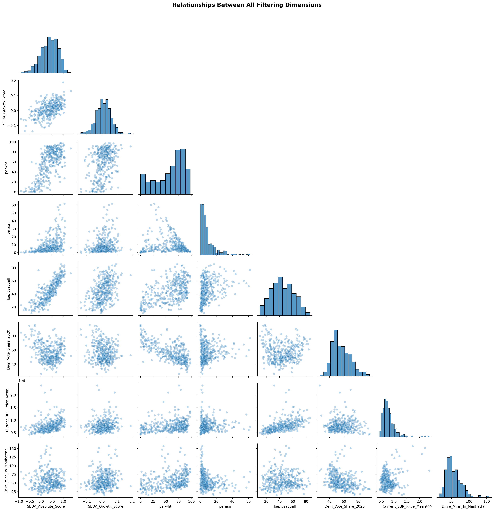
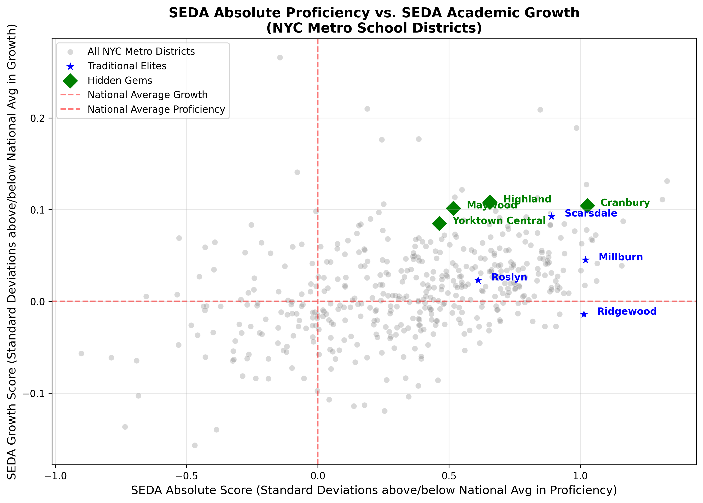

# Tri-State Suburb Relocation Analytics & Decision Engine

An end-to-end Decision Science framework and interactive screener evaluating housing affordability, commute friction, and educational quality across hundreds of New York Tri-State metropolitan municipalities.

[](https://joshuawilding.github.io/suburb-relocation-analytics/)

---

## Motivation & Problem Framing

Relocating from New York City to the surrounding suburban communities (Northern NJ, Westchester, Long Island, and Fairfield County) represents a complex, multi-objective optimization problem with stark trade-offs:
- **Commute Friction:** Train vs driving transit duration to Midtown Manhattan during peak rush hours.
- **Housing Affordability:** Multi-tier single-family price trajectories and carrying costs.
- **Educational Performance:** Longitudinal student growth versus absolute socio-demographic proficiency.
- **Walkability & Neighborhood Density:** Walkable transit hubs vs car-dependent acreage.

This project ingests, harmonizes, and models data across multiple federal and proprietary sources, producing composite desirability frontiers and an interactive screener to support data-driven relocation decisions.

---

## Data Architecture & Sources

The analytical pipeline cross-references multiple heterogeneous datasets at the census-tract, school-district, and municipal levels:

1. **EPA Smart Location Database (V3):** National walkability index, employment density, transit service frequency, and vehicle ownership rates.
2. **Zillow Home Value Index (ZHVI):** Normalized monthly home value indices across housing tiers (0.33 to 0.67 percentile) and bedroom counts.
3. **Stanford Education Data Archive (SEDA):** Longitudinal testing outcomes across grades 3-8, decomposing educational metrics into **Absolute Proficiency** (socio-economic correlated) and **SEDA Growth Rate** (district-level value-add).
4. **US Census TIGER/Line & Crosswalks:** Precise geographic boundaries and spatial joins reconciling municipal boundaries with overlapping unified and elementary school districts.

---

## Analytical Methodology

### 1. Feature Engineering & Multi-Objective Scoring
* **Commute Friction Curves:** Non-linear penalty curves applied to peak driving times and commuter rail transit durations into Penn Station and Grand Central.
* **Carrying Cost Estimator:** Real property tax rates combined with median sale prices to project annual carrying costs per district.
* **Growth vs. Proficiency Decoupling:** SEDA value-added growth rates are separated from socio-economic baseline scores to identify high-performing districts that offer superior educational returns per housing dollar.

### 2. High-Dimensional Exploratory Analysis


*Figure 1: Pairwise distributions, regression trends, and correlation matrices across academic growth, walkability, political distributions, and median housing costs.*

### 3. Education Value-Add vs. Housing Cost Frontier


*Figure 2: Academic value-added learning rates mapped against median 3-bedroom housing prices, identifying Pareto-optimal municipalities.*

### 4. Unsupervised Lifestyle Clustering
Using unsupervised clustering on normalized feature spaces (transit frequency, housing density, park accessibility, and commercial proximity), towns are classified into four distinct archetypes:
* **Transit-Dense Suburban Hubs:** Walkable downtowns, direct rail access, compact lot sizes.
* **Balanced Suburban Communities:** Strong school systems, moderate lot sizes, 45-60 min transit commutes.
* **Spacious Acreage Enclaves:** High square footage, low walkability, car-dependent infrastructure.
* **Value-Growth Corridors:** Lower entry prices with accelerating school growth trajectories.

---

## Interactive Web Screener

The repository includes a zero-dependency interactive dashboard built with vanilla JavaScript, CSS glassmorphism, and responsive design. 

👉 **[Launch the Live Suburb Screener](https://joshuawilding.github.io/suburb-relocation-analytics/)**

### Screener Features:
* **Multi-Dimensional Sliders:** Filter by minimum SEDA growth rate, absolute test scores, diversity metrics, bachelor's degree attainment, and maximum 3-bedroom home prices.
* **Real-Time Town Ranking:** Dynamic scoring and filtering across hundreds of Tri-State submarkets.
* **Side-by-Side Comparison:** Select and benchmark multiple municipalities across all core dimensions.

---

## Project Structure

```
suburb_relocation_analytics/
├── assets/                          # High-resolution analytical charts & plots
│   ├── dimensions_pairplot.png      # Correlation & distribution matrix
│   └── seda_scatter.png             # Educational growth vs price scatter
├── docs/                            # Web screener deployed via GitHub Pages
│   ├── index.html                   # Interactive UI layout
│   ├── app.js                       # Filtering, sorting, and state management
│   ├── data.js                      # Pre-baked normalized dataset
│   └── styles.css                   # Glassmorphism dark-mode UI styles
├── School_District_Analysis.ipynb   # SEDA longitudinal testing EDA
├── run_eda.py                       # Automated statistical profiling pipeline
├── append_commute_model.py          # Transit duration and commute friction scoring
├── append_advanced_zillow.py        # ZHVI time-series and bedroom tier modeling
├── append_lifestyle_label.py        # Unsupervised clustering & archetype labeling
├── evaluate_model.py                # Goodness-of-fit and sensitivity testing
├── build_choropleth_dashboard.py    # Multi-layer Folium/Plotly geospatial choropleths
└── requirements.txt                 # Python dependencies
```

---

## Quickstart

```bash
# Clone the repository
git clone https://github.com/joshuawilding/suburb-relocation-analytics.git
cd suburb-relocation-analytics

# Install dependencies
pip install -r requirements.txt

# Run the analytical profiling pipeline
python run_eda.py

# Launch the interactive web screener locally
open docs/index.html
```

---

## License
MIT License. Data derived from public federal archives (EPA SLD, SEDA) and public real estate indices.